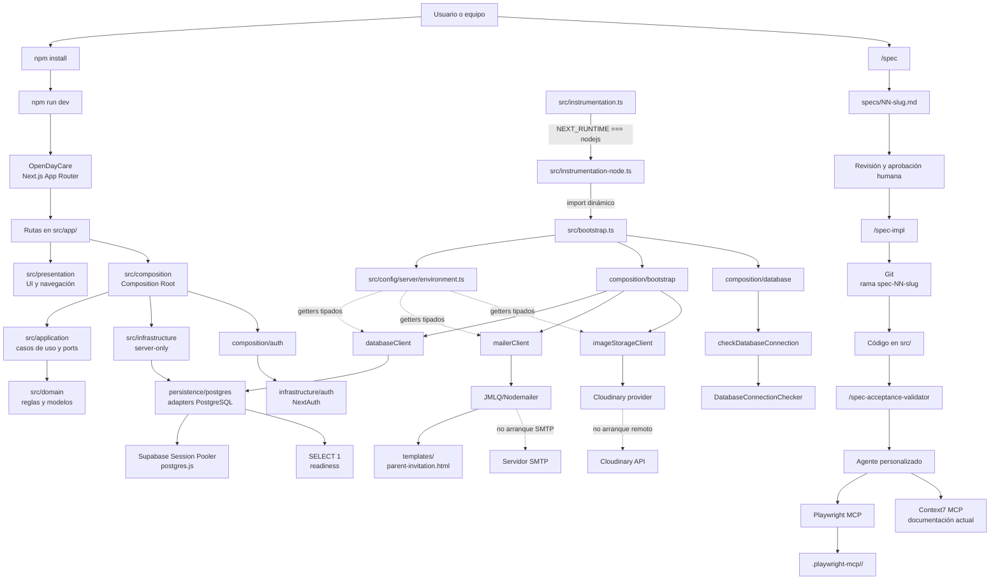
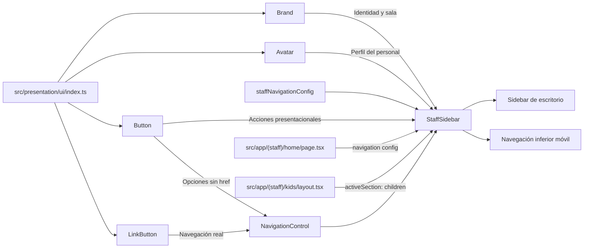

# OpenDayCare

OpenDayCare es un prototipo frontend para la gestión de una guardería ficticia,
`Sala Soles`. Este repositorio también funciona como laboratorio de desarrollo
asistido por agentes, MCPs y **Spec Driven Development (SDD)**.

La aplicación se construye a partir de especificaciones versionadas, skills
reutilizables y validaciones realizadas por agentes. La interfaz actual incluye
un feed diferenciado para personal y familias, el listado de niños y sus
perfiles, la vinculación de padres mediante invitaciones y persistencia
PostgreSQL tenant-scoped.

## Stack

- Next.js `16.4.3` con App Router.
- React `19.2.8`.
- TypeScript estricto.
- Tailwind CSS `4` y CSS Modules.
- Fredoka y Nunito mediante `next/font/google`.
- npm como gestor de paquetes.
- Alias `@/*` apuntando a `src/*`.

## Instalación y ejecución

Requiere una versión de Node.js compatible con Next.js 16. Después, instala las
dependencias y arranca el servidor:

```bash
npm install
npm run dev
```

Abre [http://localhost:3000](http://localhost:3000).

Comandos disponibles:

| Comando | Uso |
| --- | --- |
| `npm run dev` | Servidor de desarrollo |
| `npm run build` | Build de producción |
| `npm run start` | Servidor con el build generado |
| `npm run lint` | Ejecución de ESLint |
| `npm run db:migrate:dry-run` | Comprueba migraciones pendientes en el proyecto Supabase remoto enlazado |
| `npm run db:migrate` | Aplica migraciones al proyecto Supabase remoto enlazado |

Los comandos de migración requieren autenticación con Supabase y un proyecto
enlazado previamente:

```bash
npx supabase login
npx supabase link --project-ref <PROJECT_REF>
npm run db:migrate:dry-run
npm run db:migrate
```

Las migraciones se encuentran en `supabase/migrations/`. Los scripts de seed
versionados forman parte de la historia de migraciones y no son fixtures de
runtime. Se recomienda validar primero en un proyecto Supabase de prueba.

## Configuración de correo

La integración con `@jmlq/mailer` es exclusivamente server-only y se controla
mediante la fachada `mailerClient` de Infrastructure. Next.js carga las variables desde
los archivos `.env*`; la aplicación no inicializa `dotenv` por separado.

Define la configuración SMTP en un archivo local ignorado por Git, por ejemplo
`.env.local`, usando `.env.template` como referencia:

```dotenv
APP_URL=http://localhost:3000

MAILER_EMAIL=example@gmail.com
MAILER_SECRET_KEY=app_password_here
MAILER_FROM=example@gmail.com

MAIL_HOST=smtp.gmail.com
MAIL_PORT=587
MAIL_SECURE=false

MAIL_TEMPLATE_EXTENSION=html
```

`MAIL_PORT` debe ser un entero positivo y `MAIL_SECURE` acepta únicamente
`true` o `false`. Las plantillas se cargan exclusivamente desde la carpeta raíz
`templates/`, que debe existir en runtime. `APP_URL` debe ser un origen absoluto
HTTP o HTTPS y se utiliza para construir los enlaces de activación sin depender
de cabeceras de petición.

Las variables del mailer se validan durante el bootstrap de la aplicación. Una
configuración ausente o inválida impide que el servidor se considere listo. Las
credenciales reales nunca se versionan: `.gitignore` permite únicamente el archivo
de ejemplo `.env.template`.

La plantilla `templates/parent-invitation.html` forma parte de los archivos
necesarios en runtime. Un despliegue que empaquete solo el output de Next.js,
como `output: "standalone"`, debe incluir también la carpeta `templates/`.

## Rutas oficiales

- `/home`: feed del personal o feed familiar filtrado según el rol autenticado.
- `/`: redirect permanente a `/home`.
- `/auth/login`: inicio de sesión.
- `/auth/parent-invitation`: inicio de activación de una invitación.
- `/auth/parent-invitation/[token]`: activación de una invitación de padre.
- `/api/auth/[...nextauth]`: Route Handler de NextAuth v4 para credenciales y sesiones JWT.
- `/kids`: listado de ocho niños con búsqueda local y badges de alergias.
- `/kids/[slug]`: perfil de un niño con información básica, notas médicas y padres vinculados.
- `/kids/edit/[id]`: edición de un niño por ID.
- `/kids/new`: alta de un niño.
- `/kids/[slug]/invite-parent`: invitación de otro padre desde un perfil.
- `/family-feed`: feed familiar.
- `/family-feed/day-summary` y `/family-feed/account`: entradas de compatibilidad internas del feed.
- `/posts/[postId]`, `/posts/new` y `/posts/[postId]/edit`: publicaciones.
- `/posts/[postId]/comments/new` y `/posts/[postId]/comments/[commentId]/edit`: comentarios.
- `/kids/[slug]` con un slug desconocido: página 404 propia.

## PostgreSQL, Supabase y arranque server-side

La configuración transversal se centraliza en `src/config/server/environment.ts`.
Los consumidores reciben únicamente getters tipados por sección:

- `getApplicationEnvironment()`
- `getAuthEnvironment()`
- `getMailerEnvironment()`
- `getCloudinaryEnvironment()`
- `getSupabaseEnvironment()`

Configura estas variables en `.env.local` o en el gestor de secretos del entorno,
fuera de Git:

```dotenv
SUPABASE_DB_HOST=aws-0-us-east-1.pooler.supabase.com
SUPABASE_DB_PORT=5432
SUPABASE_DB_USERNAME=postgres.<PROJECT_REF>
SUPABASE_DB_PASSWORD=your_database_password
RUN_REMOTE_DB_TESTS=false
```

La aplicación usa PostgreSQL mediante `postgres.js` y el Session Pooler IPv4.
`SUPABASE_DB_PASSWORD` es server-only y nunca debe exponerse en variables
`NEXT_PUBLIC_*`. `bootstrap.ts` valida todo el entorno y configura, en orden,
`databaseClient`, `mailerClient` e `imageStorageClient`. Después ejecuta
`SELECT 1` mediante el cliente PostgreSQL para comprobar el readiness de la base.

`src/instrumentation.ts` es el adaptador mínimo del lifecycle de Next.js y carga
dinámicamente `src/bootstrap.ts` solo en el runtime Node.js. El bootstrap es
idempotente y detiene la preparación del servidor ante cualquier error de
configuración o conexión.

Esta entrega no implementa Supabase Auth ni cambia bcrypt, cookies o la estrategia
JWT. Las migraciones y seeds SQL se versionan en `supabase/migrations/`; los
repositorios PostgreSQL de Auth e invitaciones permanecen separados y no están
activados como persistencia general de las rutas productivas. Tampoco realiza
conexiones SMTP ni operaciones de Cloudinary durante el arranque. La refactorización de NextAuth mantiene Credentials,
sesiones JWT, cookies, redirects y permisos sin cambios; su API server-side se
consume desde `@/composition/auth`.

Las rutas legacy `/login`, `/kids/:id/edit`, `/auth/link-parent`, las rutas
antiguas de Posts, `/activate-account` y `/auth/activate-account` responden 404.
El redirect de compatibilidad `/` es el único redirect externo conservado.

### Invitaciones de padres

El personal con rol `personal` puede crear invitaciones desde “Vincular otro
padre” en `/kids/[slug]`. El servidor valida nombre, email y parentesco, genera
un código criptográficamente aleatorio de ocho caracteres sin símbolos ambiguos
y fija un vencimiento de siete días. La persona se crea como `parent/pending` y
la invitación se persiste bajo transacción PostgreSQL antes de contactar al mailer;
no se crea `ParentKid` durante este flujo.

Los fallos SMTP conservan los registros pendientes y muestran un error
recuperable. Un reintento de una invitación pendiente sin envío confirmado
reutiliza el código vigente o rota código y vencimiento si ya expiró. Los
envíos exitosos actualizan `sentAt` y redirigen al perfil con
`?invitation=sent`. Los padres autenticados son redirigidos a `/home`.

La aplicación usa PostgreSQL como única fuente runtime. Las pruebas remotas se
ejecutan con `RUN_REMOTE_DB_TESTS=true`, dentro de transacciones con rollback.
Mientras exista una única guardería operativa, `CurrentDaycareProvider` obtiene
provisionalmente su `daycareId` desde PostgreSQL para completar el login;
posteriormente se incorporará la selección explícita de guardería.

La activación de una invitación se realiza posteriormente desde
`/auth/parent-invitation/[token]`: crea o actualiza las credenciales, activa la persona,
crea la relación `ParentKid` y marca `acceptedAt` de forma coordinada. Un fallo
revierte la transacción PostgreSQL y conserva la invitación pendiente.

## Autenticación

La autenticación usa `next-auth@4.24.15` con Credentials Provider, sesiones JWT
de siete días y cookies HttpOnly. La API server-side se expone mediante
`src/composition/auth/`, mientras que la implementación concreta permanece en
Infrastructure. La configuración obtiene sus valores desde
`src/config/server/environment.ts`.

Añade estas variables a tu archivo local `.env` o `.env.local`, usando
`.env.template` como referencia:

```dotenv
AUTH_SECRET=replace_with_a_random_secret
AUTH_SESSION_MAX_AGE_SECONDS=604800
AUTH_SESSION_COOKIE_NAME=next-auth.session-token
AUTH_SESSION_COOKIE_HTTP_ONLY=true
AUTH_SESSION_COOKIE_SECURE=false
AUTH_SESSION_COOKIE_SAME_SITE=lax
AUTH_SESSION_COOKIE_PATH=/
AUTH_SIGN_IN_PATH=/auth/login
```

`AUTH_SECRET` debe reemplazarse por un secreto aleatorio real fuera del entorno
local. `AUTH_SESSION_COOKIE_SECURE` debe ser `true` cuando la aplicación se sirve
exclusivamente sobre HTTPS.

El personal con rol `personal` puede acceder a `/kids/**` y conserva el feed de
personal en `/home`. Los padres con rol `parent` reciben un feed familiar en
`/home`, limitado a los niños vinculados y a sus salas, y no pueden acceder a
las rutas de Kids. Las personas inexistentes, inactivas o con un rol cambiado
son expulsadas de la sesión.

El feed familiar combina publicaciones dirigidas a los niños relacionados y
anuncios de sus salas, elimina anuncios duplicados, mantiene el orden por fecha
y no expone contenido de otras familias. Incluye identidad del padre, niños
vinculados, cierre de sesión y un estado vacío seguro cuando no existen
relaciones. No muestra el composer ni la navegación exclusiva de personal.

### Credenciales demo

Estas credenciales existen únicamente para pruebas locales del prototipo:

| Usuario | Email | Password | Rol |
| --- | --- | --- | --- |
| Caro Giménez | `caro@opendaycare.com` | `OpenDayCare1!` | `personal` |

Los demás hashes `mock-hash-*` de los fixtures no son contraseñas válidas.
No reutilices la clave demo ni agregues credenciales reales al repositorio.

## Arquitectura

La aplicación separa routing, casos de uso, dominio, adapters, presentación y
composición. El prefijo físico `src` se oculta en imports mediante `@/*`:

```text
open-daycare/
├── src/
│   ├── app/                    Routing y adapters de entrada de Next.js
│   │   ├── (staff)/            Rutas de personal sin segmento público
│   │   ├── (general)/          Rutas generales y Posts
│   │   ├── auth/               Rutas públicas de autenticación
│   │   └── api/auth/[...nextauth]/ Route Handler de NextAuth
│   ├── application/            Use cases, commands, queries, DTOs y ports
│   ├── domain/                 Entidades, invariantes y reglas puras
│   ├── config/                 Configuración runtime y server-only tipada
│   ├── infrastructure/         Repositorios, proveedores y adapters server-only
│   ├── presentation/           UI, layout, navegación, presenters y view models
│   ├── composition/            Factories que ensamblan Application e Infrastructure
│   ├── bootstrap.ts             Inicialización server-only idempotente
│   ├── instrumentation.ts       Adaptador del lifecycle de Next.js
│   ├── types/                  Ampliaciones TypeScript de NextAuth
│   └── ...                      Entrypoints y colaboradores de ruta
├── public/                    Recursos públicos
├── templates/                 Plantillas HTML requeridas en runtime
├── supabase/
│   ├── migrations/            Migraciones y seeds SQL versionados
│   └── config.toml            Configuración de Supabase CLI
├── specs/                   Contratos funcionales versionados
├── .agents/skills/          Skills del flujo SDD
├── .opencode/               Agentes y comandos personalizados
├── references/              Prototipos HTML y capturas visuales
└── .playwright-mcp/         Evidencia de validaciones visuales
```

Los modelos de dominio viven en `src/domain/`. PostgreSQL es la única fuente de
datos runtime y solo se accede mediante adapters server-only. `src/presentation/` no depende de Infrastructure ni
Composition; `src/application/` no depende de Infrastructure, Next.js ni React;
`src/domain/` no depende de otras capas ni de proveedores externos. Las páginas
y Server Actions de `src/app/` delegan en casos de uso ensamblados por
`src/composition/`. Los Client Components reciben DTOs mínimos proyectados por
el servidor y no importan Infrastructure ni configuración privada.

### Diagrama del laboratorio



El diagrama se mantiene alineado con la arquitectura actual: las rutas no
construyen adapters, Application solo conoce ports y Composition ensambla las
implementaciones. El flujo de arranque es independiente del flujo de requests;
`instrumentation.ts` carga el bootstrap únicamente en Node.js. Mailer y
Cloudinary se configuran durante el arranque, pero el readiness de base se
verifica mediante PostgreSQL con `SELECT 1`. Las migraciones se ejecutan de forma
explícita mediante Supabase CLI y no forman parte del bootstrap.

## ¿Qué es una spec?

Una **spec** es el contrato que describe una funcionalidad antes de escribir su
código. Define el objetivo, alcance, modelo de datos, plan de implementación,
criterios de aceptación, decisiones y riesgos.

Las specs se almacenan en `specs/` con el formato `NN-slug.md`. Sus estados son:

1. `Draft`: definición inicial.
2. `In review`: revisión del contenido.
3. `Approved`: lista para implementación.
4. `Implement`: implementación realizada y aceptación en validación.
5. `Implemented`: implementación y aceptación completadas.
6. `Obsolete`: reemplazada o descartada.

## Flujo Spec Driven Development

```text
1. /spec "nueva funcionalidad"
   └─> preguntas, alcance, decisiones y specs/NN-slug.md (Draft)

2. Revisión humana
   └─> cambio manual del estado a Approved

3. /spec-impl NN-slug
   └─> rama spec-NN-slug
       └─> implementación por pasos con pausas para revisar diffs

4. /spec-acceptance-validator NN-slug
   └─> criterios verificados, correcciones necesarias y evidencia

5. Revisión final humana
   └─> estado Implemented, commit, merge y push según el flujo del equipo
```

`specs/.spec-config.yml` controla la creación de ramas:

```yaml
AutoCreateBranch: true
```

Con `true`, `/spec-impl` crea y cambia automáticamente a `spec-NN-slug`. Con
`false`, solicita confirmación antes de tocar Git. El agente no debe hacer
commit, push o merge automáticamente.

## MCPs utilizados

### Playwright MCP

Está configurado en `opencode.json` como servidor local habilitado:

```text
npx -y @playwright/mcp@latest
```

Se usa para comprobar páginas renderizadas, responsive, accesibilidad,
interacciones, navegación, consola, red y payloads. Sus capturas y artefactos
se guardan en `.playwright-mcp/<Feature>/`.

### Context7 MCP

Está configurado a nivel de usuario y se utiliza para consultar documentación
actualizada de frameworks, SDKs, APIs y herramientas. Su configuración privada
y cualquier credencial quedan fuera del repositorio.

## Skills instaladas

Las skills del proyecto están bajo `.agents/skills/` y su procedencia se registra
en `skills-lock.json`.

### `spec`

Diseña specs mediante preguntas guiadas. Ayuda a cerrar alcance, datos,
integración, UX, decisiones y criterios antes de generar el archivo Markdown.
No implementa código.

Uso:

```text
/spec <descripción breve de la funcionalidad>
```

### `spec-impl`

Implementa una spec únicamente cuando su estado es `Approved`. Gestiona la rama
de la spec, muestra el plan y trabaja un paso a la vez, esperando revisión del
diff entre pasos.

Uso:

```text
/spec-impl 04-kid-allergy-tags
/spec-impl 04
/spec-impl kid-allergy-tags
```

## Agente y comando personalizados

### `spec-acceptance-validator`

Agente definido en
`.opencode/agent/spec-acceptance-validator.md`. Revisa cada criterio de
aceptación individualmente, usa Playwright cuando corresponde, ejecuta las
comprobaciones relevantes y corrige solo incumplimientos necesarios. Marca un
criterio como verificado únicamente cuando existe evidencia.

### `/spec-acceptance-validator`

Comando definido en `.opencode/command/spec-acceptance-validator.md`:

```text
/spec-acceptance-validator <spec>
```

## Git y colaboración

Cada spec puede trabajarse en su propia rama con la convención:

```text
spec-NN-slug
```

El archivo `specs/.spec-config.yml` define si la rama se crea automáticamente.
Los cambios se revisan mediante diffs antes de confirmar commits. Git conserva
la relación entre la spec, su implementación y la evidencia de aceptación.

## Referencias visuales

`references/` contiene prototipos HTML y capturas que sirven como referencia de
diseño. No es código de runtime. Las pantallas aún no implementadas no implican
que exista una ruta funcional en la aplicación.

Para conocer las reglas completas de arquitectura, estilos, Server Components,
Client Components y verificación, consulta `AGENTS.md`.

## Componentes UI reutilizables

Los componentes visuales compartidos viven en `src/presentation/ui/` y se
consumen mediante su barrel público `src/presentation/ui/index.ts`. No contienen
datos de negocio: reciben contenido, variantes, destinos y `className` mediante
props.

`StaffSidebar` compone estos componentes para mantener una interfaz consistente
en escritorio y móvil:



Dentro de `NavigationControl`, `LinkButton` se usa cuando una opción tiene un
destino real y `Button` cuando la opción es presentacional. El mismo control se
reutiliza en la navegación lateral de escritorio y en la navegación inferior
móvil.

`Badge` y `SearchField` también forman parte del catálogo UI reutilizable, pero
se utilizan en otras features y no dentro de `StaffSidebar`.
