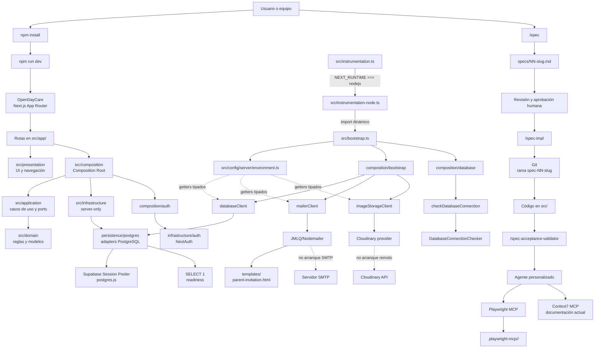
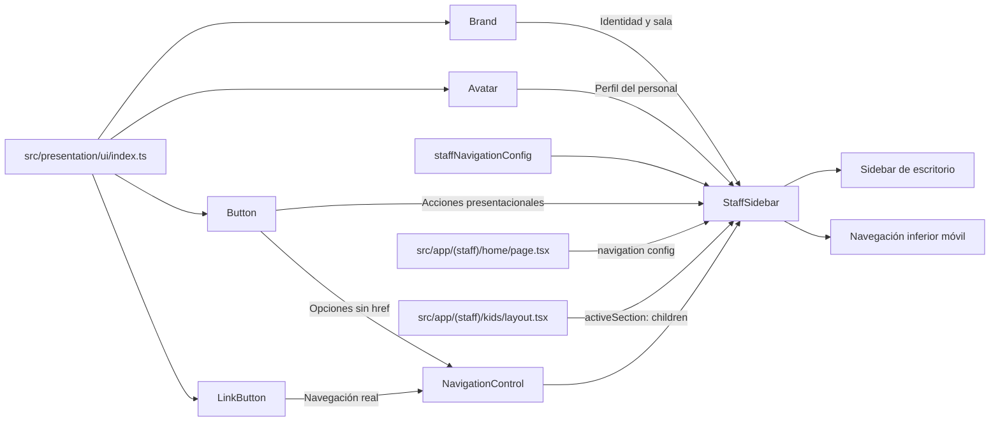

# OpenDayCare

OpenDayCare es un prototipo frontend para la gestión de una guardería ficticia,
`Sala Soles`. Este repositorio también funciona como laboratorio de desarrollo
asistido por agentes, MCPs y **Spec Driven Development (SDD)**.

La aplicación se construye a partir de especificaciones versionadas, skills
reutilizables y validaciones realizadas por agentes. La interfaz actual incluye
un feed diferenciado para personal y familias, el listado de niños y sus
perfiles, la vinculación de padres mediante invitaciones y persistencia
PostgreSQL tenant-scoped.

## Stack

- Next.js `16.4.3` con App Router.
- React `19.2.8`.
- TypeScript estricto.
- Tailwind CSS `4` y CSS Modules.
- Fredoka y Nunito mediante `next/font/google`.
- npm como gestor de paquetes.
- Alias `@/*` apuntando a `src/*`.

## Instalación y ejecución

Requiere una versión de Node.js compatible con Next.js 16. Después, instala las
dependencias y arranca el servidor:

```bash
npm install
npm run dev
```

El servidor de desarrollo y el servidor de producción usan explícitamente el
puerto `3000`. Abre [http://localhost:3000](http://localhost:3000).

Si el puerto está ocupado, Next.js no debe iniciar otro servidor en un puerto
aleatorio. Libera primero el proceso que lo usa en PowerShell:

```powershell
Get-NetTCPConnection -LocalPort 3000 -State Listen |
  Select-Object -ExpandProperty OwningProcess -Unique |
  Stop-Process -Force
```

Después vuelve a ejecutar `npm run dev`. Todas las rutas de App Router usan el
mismo origen y puerto; no se configura un puerto diferente por ruta.

Comandos disponibles:

| Comando                      | Uso                                                                                |
| ---------------------------- | ---------------------------------------------------------------------------------- |
| `npm run dev`                | Servidor de desarrollo                                                             |
| `npm run build`              | Build de producción                                                                |
| `npm run start`              | Servidor con el build generado                                                     |
| `npm run lint`               | Ejecución de ESLint                                                                |
| `npm run db:migrate:dry-run` | Comprueba migraciones pendientes en el proyecto Supabase remoto enlazado           |
| `npm run db:migrate`         | Aplica migraciones al proyecto Supabase remoto enlazado                            |
| `npm run db:seed`            | Ejecuta explícitamente `supabase/seed.sql` en el proyecto Supabase remoto enlazado |

### Baseline y seed de un proyecto nuevo

La migración baseline y `supabase/seed.sql` pertenecen al aprovisionamiento de
un proyecto Supabase nuevo, después de que SPEC 34 adapte el runtime. No se debe
ejecutar `npm run db:seed` contra un proyecto que contenga datos históricos.
Las migraciones posteriores de seguridad pueden desplegarse manualmente al
remoto de test únicamente después de verificar el proyecto, revisar el dry-run
y completar las prevalidaciones de datos descritas en la sección del auditor.

Antes de ejecutar cualquiera de los dos comandos, verifica el proyecto enlazado
y enlaza explícitamente el proyecto nuevo:

Los comandos de migración requieren autenticación con Supabase y un proyecto
enlazado previamente:

```bash
npx supabase login
npx supabase link --project-ref <NEW_PROJECT_REF>
npm run db:migrate:dry-run
npm run db:migrate
npm run db:seed
```

`db:migrate` solo aplica los archivos de `supabase/migrations/`. El seed no se
ejecuta implícitamente durante una migración: `db:seed` es la única operación que
ejecuta `supabase/seed.sql`, dentro de su propia transacción. No se debe ejecutar
`db:seed` hasta comprobar que el enlace apunta al proyecto nuevo correcto.

### Evidencia del baseline SPEC 33

La estructura y el seed se validaron el 2026-11-06 contra el PostgreSQL local de
Supabase. La migración `20261106215827_database_baseline.sql` se aplicó sobre una
base vacía y `supabase/seed.sql` se ejecutó dos veces.

Conteos observados después del segundo ciclo:

| Entidad        |  Filas |
| -------------- | -----: |
| `daycares`     |      1 |
| `roles`        |      4 |
| `people`       |      1 |
| `credential`   |      1 |
| `people_roles` |      3 |
| `rooms`        |      3 |
| `staff_rooms`  |      3 |
| **Total**      | **16** |

Relaciones verificadas:

- Caro Giménez (`caro@opendaycare.com`) está activa y tiene el cargo `Maestra`.
- Sus roles en el daycare son `admin`, `personal` y `teacher`.
- Está asignada a `Soles`, `Girasoles` y `Patitos` mediante `staff_rooms`.
- `person_role` contiene exactamente `admin`, `personal`, `teacher` y `parent`.
- `feed_overview` no existe.
- La segunda ejecución no añadió filas en `people_roles` ni `staff_rooms`.

Credencial de bootstrap para el primer acceso en el proyecto nuevo:

```text
Email:    caro@opendaycare.com
Password: OpenDayCare1!
```

El seed guarda el hash bcrypt existente para esa contraseña. Esta credencial es
solo de bootstrap y debe rotarse antes de usar el proyecto en un entorno real.
La validación no creó niños, padres, invitaciones, publicaciones, comentarios,
reacciones, media ni históricos.

## Configuración de correo

La integración con `@jmlq/mailer` es exclusivamente server-only y se controla
mediante la fachada `mailerClient` de Infrastructure. Next.js carga las variables desde
los archivos `.env*`; la aplicación no inicializa `dotenv` por separado.

Define la configuración SMTP en un archivo local ignorado por Git, por ejemplo
`.env.local`, usando `.env.template` como referencia:

```dotenv
APP_URL=http://localhost:3000
NEXTAUTH_URL=http://localhost:3000

MAILER_EMAIL=example@gmail.com
MAILER_SECRET_KEY=app_password_here
MAILER_FROM=example@gmail.com

MAIL_HOST=smtp.gmail.com
MAIL_PORT=587
MAIL_SECURE=false

MAIL_TEMPLATE_EXTENSION=html
```

`MAIL_PORT` debe ser un entero positivo y `MAIL_SECURE` acepta únicamente
`true` o `false`. Las plantillas se cargan exclusivamente desde la carpeta raíz
`templates/`, que debe existir en runtime. `APP_URL` debe ser un origen absoluto
HTTP o HTTPS y se utiliza para construir los enlaces de activación sin depender
de cabeceras de petición.

Las variables del mailer se validan durante el bootstrap de la aplicación. Una
configuración ausente o inválida impide que el servidor se considere listo. Las
credenciales reales nunca se versionan: `.gitignore` permite únicamente el archivo
de ejemplo `.env.template`.

La plantilla `templates/parent-invitation.html` forma parte de los archivos
necesarios en runtime. Un despliegue que empaquete solo el output de Next.js,
como `output: "standalone"`, debe incluir también la carpeta `templates/`.

## Rutas oficiales

- `/home`: feed del personal o feed familiar filtrado según el rol autenticado.
- `/account`: cuenta del personal autenticado, con edición de nombre y teléfono,
  cambio de contraseña y cierre de sesión.
- `/`: redirect permanente a `/home`.
- `/auth/login`: inicio de sesión.
- `/auth/parent-invitation`: inicio de activación de una invitación.
- `/auth/parent-invitation/[token]`: activación de una invitación de padre.
- `/api/auth/[...nextauth]`: Route Handler de NextAuth v4 para credenciales y sesiones JWT.
- `/kids`: listado de ocho niños con búsqueda local y badges de alergias.
- `/kids/[slug]`: perfil de un niño con información básica, notas médicas y padres vinculados.
- `/kids/edit/[id]`: edición de un niño por ID.
- `/kids/new`: alta de un niño.
- `/kids/[slug]/invite-parent`: invitación de otro padre desde un perfil.
- `/family-feed`: feed familiar.
- `/family-feed/day-summary` y `/family-feed/account`: entradas de compatibilidad internas del feed.
- `/posts/[postId]`, `/posts/new` y `/posts/[postId]/edit`: publicaciones.
- `/posts/[postId]/comments/new` y `/posts/[postId]/comments/[commentId]/edit`: comentarios.
- `/kids/[slug]` con un slug desconocido: página 404 propia.

## PostgreSQL, Supabase y arranque server-side

La configuración transversal se centraliza en `src/config/server/environment.ts`.
Los consumidores reciben únicamente getters tipados por sección:

- `getApplicationEnvironment()`
- `getAuthEnvironment()`
- `getMailerEnvironment()`
- `getCloudinaryEnvironment()`
- `getSupabaseEnvironment()`

Configura estas variables en `.env.local` o en el gestor de secretos del entorno,
fuera de Git:

```dotenv
SUPABASE_DB_HOST=aws-0-us-east-1.pooler.supabase.com
SUPABASE_DB_PORT=5432
SUPABASE_DB_USERNAME=postgres.<PROJECT_REF>
SUPABASE_DB_PASSWORD=your_database_password
RUN_REMOTE_DB_TESTS=false
```

La configuración regional server-only requiere una zona horaria IANA. Para
Ecuador continental usa:

```dotenv
APP_LOCALE=es-EC
APP_TIME_ZONE=America/Guayaquil
```

Las fechas PostgreSQL recibidas como instantes se normalizan a `YYYY-MM-DD` en
esta zona antes de mapearse al dominio. `APP_LOCALE` controla el idioma y
formato regional de las fechas mostradas.

La aplicación usa PostgreSQL mediante `postgres.js` y el Session Pooler IPv4.
`SUPABASE_DB_PASSWORD` es server-only y nunca debe exponerse en variables
`NEXT_PUBLIC_*`. `bootstrap.ts` valida todo el entorno y configura, en orden,
`databaseClient`, `mailerClient` e `imageStorageClient`. Después ejecuta
`SELECT 1` mediante el cliente PostgreSQL para comprobar el readiness de la base.

`src/instrumentation.ts` es el adaptador mínimo del lifecycle de Next.js y carga
dinámicamente `src/bootstrap.ts` solo en el runtime Node.js. El bootstrap es
idempotente y detiene la preparación del servidor ante cualquier error de
configuración o conexión.

Esta entrega no implementa Supabase Auth ni cambia bcrypt, cookies o la estrategia
JWT. La migración estructural se versiona en `supabase/migrations/` y el seed
independiente en `supabase/seed.sql`. Auth,
Staff y General usan PostgreSQL como persistencia runtime a través de sus
composiciones server-only; no existe fallback JSON ni traducción de IDs legacy.
Tampoco realiza conexiones SMTP ni operaciones de Cloudinary durante el
arranque. La refactorización de NextAuth mantiene Credentials, sesiones JWT,
cookies, redirects y permisos sin cambios; su API server-side se consume desde
`@/composition/auth`.

Las rutas legacy `/login`, `/kids/:id/edit`, `/auth/link-parent`, las rutas
antiguas de Posts, `/activate-account` y `/auth/activate-account` responden 404.
El redirect de compatibilidad `/` es el único redirect externo conservado.

### Invitaciones de padres

El personal con rol `personal` puede crear invitaciones desde “Vincular otro
padre” en `/kids/[slug]`. El servidor valida nombre, email y parentesco, genera
un código criptográficamente aleatorio de ocho caracteres sin símbolos ambiguos
y fija un vencimiento de siete días. La persona se crea como `parent/pending` y
la invitación se persiste bajo transacción PostgreSQL antes de contactar al mailer;
no se crea `ParentKid` durante este flujo.

Los fallos SMTP conservan los registros pendientes y muestran un error
recuperable. Un reintento de una invitación pendiente sin envío confirmado
reutiliza el código vigente o rota código y vencimiento si ya expiró. Los
envíos exitosos actualizan `sentAt` y redirigen al perfil con
`?invitation=sent`. Los padres autenticados son redirigidos a `/home`.

La aplicación usa PostgreSQL como única fuente runtime. Las pruebas remotas se
ejecutan con `RUN_REMOTE_DB_TESTS=true`, dentro de transacciones con rollback.
Mientras exista una única guardería operativa, `CurrentDaycareProvider` obtiene
provisionalmente su `daycareId` desde PostgreSQL para completar el login;
posteriormente se incorporará la selección explícita de guardería.

**Runtime source: PostgreSQL/Supabase.** Los 11 JSON son snapshots inmutables
de migración y no forman parte del runtime ni se escriben durante la ejecución.

### Rollback operativo del cutover

1. Detener el tráfico autenticado y conservar los logs de readiness sin incluir
   credenciales, headers ni datos de respuestas.
2. Si falla una operación de negocio, dejar que la transacción PostgreSQL la
   revierta; no restaurar JSON ni activar un fallback híbrido.
3. Si falla el despliegue, volver a la última versión compatible con PostgreSQL
   y mantener la misma configuración de base de datos. No volver a una versión
   que use IDs JSON como fuente runtime.
4. Comprobar `SELECT 1`, ejecutar los smoke tests y exigir un nuevo login. Las
   sesiones antiguas o sin `persistenceSource: "postgres"` permanecen inválidas.
5. Reanudar tráfico solo después de confirmar aislamiento por `daycareId` y que
   las escrituras remotas de prueba siguen usando rollback.

La activación de una invitación se realiza posteriormente desde
`/auth/parent-invitation/[token]`: crea o actualiza las credenciales, activa la persona,
crea la relación `ParentKid` y marca `acceptedAt` de forma coordinada. Un fallo
revierte la transacción PostgreSQL y conserva la invitación pendiente.

## Autenticación

La autenticación usa `next-auth@4.24.15` con Credentials Provider, sesiones JWT
de siete días y cookies HttpOnly. La API server-side se expone mediante
`src/composition/auth/`, mientras que la implementación concreta permanece en
Infrastructure. La configuración obtiene sus valores desde
`src/config/server/environment.ts`.

Añade estas variables a tu archivo local `.env` o `.env.local`, usando
`.env.template` como referencia:

```dotenv
AUTH_SECRET=replace_with_a_random_secret
AUTH_SESSION_MAX_AGE_SECONDS=604800
AUTH_SESSION_COOKIE_NAME=next-auth.session-token
AUTH_SESSION_COOKIE_HTTP_ONLY=true
AUTH_SESSION_COOKIE_SECURE=false
AUTH_SESSION_COOKIE_SAME_SITE=lax
AUTH_SESSION_COOKIE_PATH=/
AUTH_SIGN_IN_PATH=/auth/login
```

`NEXTAUTH_URL` debe coincidir con el origen usado por el servidor. En local es
`http://localhost:3000`; en otros entornos debe usar el origen público HTTPS
correspondiente. `PORT` no se configura en `.env` porque Next.js necesita
resolver el puerto antes de cargar las variables de la aplicación.

`AUTH_SECRET` debe reemplazarse por un secreto aleatorio real fuera del entorno
local. `AUTH_SESSION_COOKIE_SECURE` debe ser `true` cuando la aplicación se sirve
exclusivamente sobre HTTPS.

El personal con rol `personal` puede acceder a `/kids/**` y conserva el feed de
personal en `/home`. Los padres con rol `parent` reciben un feed familiar en
`/home`, limitado a los niños vinculados y a sus salas, y no pueden acceder a
las rutas de Kids. Las personas inexistentes, inactivas o con un rol cambiado
son expulsadas de la sesión.

El feed familiar combina publicaciones dirigidas a los niños relacionados y
anuncios de sus salas, elimina anuncios duplicados, mantiene el orden por fecha
y no expone contenido de otras familias. Incluye identidad del padre, niños
vinculados, cierre de sesión y un estado vacío seguro cuando no existen
relaciones. No muestra el composer ni la navegación exclusiva de personal.

### Credenciales demo

Estas credenciales existen únicamente para pruebas locales del prototipo:

| Usuario      | Email                  | Password        | Rol        |
| ------------ | ---------------------- | --------------- | ---------- |
| Caro Giménez | `caro@opendaycare.com` | `OpenDayCare1!` | `personal` |

Los demás hashes `mock-hash-*` de los fixtures no son contraseñas válidas.
No reutilices la clave demo ni agregues credenciales reales al repositorio.

## Arquitectura

La aplicación separa routing, casos de uso, dominio, adapters, presentación y
composición. El prefijo físico `src` se oculta en imports mediante `@/*`:

```text
open-daycare/
├── src/
│   ├── app/                    Routing y adapters de entrada de Next.js
│   │   ├── (staff)/            Rutas de personal sin segmento público
│   │   ├── (general)/          Rutas generales y Posts
│   │   ├── auth/               Rutas públicas de autenticación
│   │   └── api/auth/[...nextauth]/ Route Handler de NextAuth
│   ├── application/            Use cases, commands, queries, DTOs y ports
│   ├── domain/                 Entidades, invariantes y reglas puras
│   ├── config/                 Configuración runtime y server-only tipada
│   ├── infrastructure/         Repositorios, proveedores y adapters server-only
│   ├── presentation/           UI, layout, navegación, presenters y view models
│   ├── composition/            Factories que ensamblan Application e Infrastructure
│   ├── bootstrap.ts             Inicialización server-only idempotente
│   ├── instrumentation.ts       Adaptador del lifecycle de Next.js
│   ├── types/                  Ampliaciones TypeScript de NextAuth
│   └── ...                      Entrypoints y colaboradores de ruta
├── public/                    Recursos públicos
├── templates/                 Plantillas HTML requeridas en runtime
├── supabase/
│   ├── migrations/            Única migración estructural versionada
│   ├── seed.sql               Seed bootstrap independiente y explícito
│   └── config.toml            Configuración de Supabase CLI
├── specs/                   Contratos funcionales versionados
├── .agents/skills/          Skills del flujo SDD
├── .opencode/               Agentes y comandos personalizados
├── references/              Prototipos HTML y capturas visuales
└── .playwright-mcp/         Evidencia de validaciones visuales
```

Los modelos de dominio viven en `src/domain/`. PostgreSQL es la única fuente de
datos runtime y solo se accede mediante adapters server-only. `src/presentation/` no depende de Infrastructure ni
Composition; `src/application/` no depende de Infrastructure, Next.js ni React;
`src/domain/` no depende de otras capas ni de proveedores externos. Las páginas
y Server Actions de `src/app/` delegan en casos de uso ensamblados por
`src/composition/`. Los Client Components reciben DTOs mínimos proyectados por
el servidor y no importan Infrastructure ni configuración privada.

### Diagrama del laboratorio



El diagrama se mantiene alineado con la arquitectura actual: las rutas no
construyen adapters, Application solo conoce ports y Composition ensambla las
implementaciones. El flujo de arranque es independiente del flujo de requests;
`instrumentation.ts` carga el bootstrap únicamente en Node.js. Mailer y
Cloudinary se configuran durante el arranque, pero el readiness de base se
verifica mediante PostgreSQL con `SELECT 1`. Las migraciones se ejecutan de forma
explícita mediante Supabase CLI y no forman parte del bootstrap.

## ¿Qué es una spec?

Una **spec** es el contrato que describe una funcionalidad antes de escribir su
código. Define el objetivo, alcance, modelo de datos, plan de implementación,
criterios de aceptación, decisiones y riesgos.

Las specs se almacenan en `specs/` con el formato `NN-slug.md`. Sus estados son:

1. `Draft`: definición inicial.
2. `In review`: revisión del contenido.
3. `Approved`: lista para implementación.
4. `Implement`: implementación realizada y aceptación en validación.
5. `Implemented`: implementación y aceptación completadas.
6. `Obsolete`: reemplazada o descartada.

## Flujo Spec Driven Development

```text
1. /spec "nueva funcionalidad"
   └─> preguntas, alcance, decisiones y specs/NN-slug.md (Draft)

2. Revisión humana
   └─> cambio manual del estado a Approved

3. /spec-impl NN-slug
   └─> rama spec-NN-slug
       └─> implementación por pasos con pausas para revisar diffs

4. /spec-acceptance-validator NN-slug
   └─> criterios verificados, correcciones necesarias y evidencia

5. Revisión final humana
   └─> estado Implemented, commit, merge y push según el flujo del equipo
```

`specs/.spec-config.yml` controla la creación de ramas:

```yaml
AutoCreateBranch: true
```

Con `true`, `/spec-impl` crea y cambia automáticamente a `spec-NN-slug`. Con
`false`, solicita confirmación antes de tocar Git. El agente no debe hacer
commit, push o merge automáticamente.

## MCPs utilizados

### Playwright MCP

Está configurado en `opencode.json` como servidor local habilitado:

```text
npx -y @playwright/mcp@latest
```

Se usa para comprobar páginas renderizadas, responsive, accesibilidad,
interacciones, navegación, consola, red y payloads. Sus capturas y artefactos
se guardan en `.playwright-mcp/<Feature>/`.

### Context7 MCP

Está configurado a nivel de usuario y se utiliza para consultar documentación
actualizada de frameworks, SDKs, APIs y herramientas. Su configuración privada
y cualquier credencial quedan fuera del repositorio.

## Skills instaladas

Las skills del proyecto están bajo `.agents/skills/` y su procedencia se registra
en `skills-lock.json`.

### `spec`

Diseña specs mediante preguntas guiadas. Ayuda a cerrar alcance, datos,
integración, UX, decisiones y criterios antes de generar el archivo Markdown.
No implementa código.

Uso:

```text
/spec <descripción breve de la funcionalidad>
```

### `spec-impl`

Implementa una spec únicamente cuando su estado es `Approved`. Gestiona la rama
de la spec, muestra el plan y trabaja un paso a la vez, esperando revisión del
diff entre pasos.

Uso:

```text
/spec-impl 04-kid-allergy-tags
/spec-impl 04
/spec-impl kid-allergy-tags
```

## Agentes personalizados

Los agentes reutilizables del proyecto están definidos en `.opencode/agents/`.
Se invocan mencionando su nombre, por ejemplo `@accessibility-checker`, y se
les deben proporcionar los archivos o la spec que delimitan su trabajo.

### `@accessibility-checker`

Revisa y corrige los archivos indicados por el usuario según WCAG 2.2 niveles A
y AA. Comprueba semántica HTML, nombres accesibles, formularios, teclado, foco,
ARIA, estados dinámicos, contraste y responsive. Aplica correcciones enfocadas
sin modificar archivos no relacionados y reporta las verificaciones que aún
requieren navegador, zoom, estilos computados o tecnología de asistencia.

Úsalo cuando se necesite revisar o mejorar la accesibilidad de una pantalla o
componente específico:

```text
@accessibility-checker @src/app/auth/login/page.tsx
```

### `@react-best-practices`

Revisa y mejora la implementación React del proyecto. Evalúa Hooks, pureza de
componentes, estado, Effects, keys, límites Server/Client, imports,
composición, tipos y comportamiento accesible. Consulta la documentación
actual de React y Next.js cuando el cambio depende del framework.

Úsalo para revisiones o refactorizaciones de componentes React, Hooks y JSX.

### `@db-migrator`

Verifica y aplica migraciones Supabase versionadas únicamente en el stack local
de desarrollo. Ejecuta el dry-run local, detecta drift, revisa riesgos de
seguridad y confirma el resultado después de una aplicación autorizada.
Nunca accede ni modifica staging, producción, proyectos remotos, URLs de base
de datos ni credenciales de producción. Las migraciones validadas localmente
se despliegan a producción mediante el proceso autorizado de CI o despliegue,
no mediante este agente.

Úsalo ante cambios de tablas, columnas, índices, constraints, RLS, funciones,
triggers u otra estructura persistida.

### `@db-security-auditor`

Audita y corrige riesgos de seguridad en PostgreSQL/Supabase y en las capas de
autorización de la aplicación. Su foco es evitar fugas entre guarderías, niños,
padres y personal, además de detectar IDOR/BOLA, filtros de tenant ausentes,
roles mal configurados, sesiones obsoletas, relaciones padre-niño inseguras,
RLS incompleto, grants excesivos, vistas inseguras y funciones
`SECURITY DEFINER` peligrosas.

Úsalo antes de exponer nuevas tablas, roles, endpoints o flujos de invitación,
familia, publicaciones, archivos y datos médicos; también después de cambios
en migraciones o autorización:

```text
@db-security-auditor revisa la seguridad de parent_kids, kids y family-feed
```

Puede auditar la base Supabase remota de **test** en modo estrictamente lectura cuando el
usuario lo solicite y la identidad del proyecto esté autorizada, usando solo
una conexión SQL/CLI de lectura ya configurada. No usa Supabase MCP. Puede
modificar código, pruebas y crear migraciones versionadas enfocadas, pero no
aplica SQL ni ejecuta migraciones remotas. Todo cambio de base de datos debe
entregarse después a `@db-migrator` para dry-run y aplicación autorizada en el
stack local, seguido del proceso separado de despliegue al remoto de test.

El agente no usa Supabase MCP, Docker local ni servicios locales para la
auditoría. La conexión se obtiene desde `SECURITY_AUDITOR_DB_URL` y
`SECURITY_AUDITOR_DB_PASSWORD` en `.env`, usando consultas CLI con
`--read-only`. La contraseña no se incluye en migraciones, código, logs ni
prompts.

### Flujo de migraciones y auditoría remota de test

Este procedimiento es manual y apunta exclusivamente al proyecto Supabase
remoto de test. No usa Docker local, GitHub Actions ni Supabase MCP.

#### 1. Configurar `.env`

Verifica que el archivo no esté versionado:

```powershell
git check-ignore -v .env
git ls-files .env
```

Añade las variables fuera de Git. Nunca incluyas la contraseña dentro de la
URL del auditor:

```dotenv
SUPABASE_DB_PASSWORD=<database-admin-password>
SUPABASE_DB_URL=postgresql://postgres.<PROJECT_REF>@<POOLER_HOST>:5432/postgres?sslmode=require
SECURITY_AUDITOR_DB_PASSWORD=<auditor-password>
SECURITY_AUDITOR_DB_URL=postgresql://security_auditor.<PROJECT_REF>@<POOLER_HOST>:5432/postgres?sslmode=require
```

`SUPABASE_DB_PASSWORD` es la contraseña administrativa usada únicamente para
las migraciones. `SUPABASE_DB_URL` y `SECURITY_AUDITOR_DB_URL` no contienen
contraseñas. `SECURITY_AUDITOR_DB_PASSWORD` pertenece exclusivamente al rol
auditor.

#### 2. Cargar variables sin mostrarlas

```powershell
function Get-DotEnvValue([string]$Name) {
  $line = Get-Content .env |
    Where-Object { $_ -match "^\s*$([regex]::Escape($Name))=" } |
    Select-Object -First 1

  if (-not $line) { throw "No se encontró $Name en .env" }

  return (($line -split "=", 2)[1]).Trim().Trim('"').Trim("'")
}

$adminPassword = Get-DotEnvValue "SUPABASE_DB_PASSWORD"
$adminDbUrl = Get-DotEnvValue "SUPABASE_DB_URL"
$auditorPassword = Get-DotEnvValue "SECURITY_AUDITOR_DB_PASSWORD"
$auditorDbUrl = Get-DotEnvValue "SECURITY_AUDITOR_DB_URL"

foreach ($value in @($adminDbUrl, $auditorDbUrl)) {
  if ([string]::IsNullOrWhiteSpace($value) -or $value.Contains('<')) {
    throw "La URL de base de datos contiene un placeholder o está vacía"
  }
}

$env:SUPABASE_DB_PASSWORD = $adminPassword
```

Las variables de PowerShell son temporales: se pierden al cerrar la consola,
abrir otra sesión o ejecutar el proceso desde otro agente. Por eso, no se debe
intentar conservar `$adminPassword`, `$auditorPassword` o `$env:PGPASSWORD` en
un archivo `.ps1`. Si se abre una nueva consola, vuelve a ejecutar la función
anterior para cargar los valores desde `.env`. El agente auditor lee las
variables persistentes de `.env`; no depende de las variables de la consola
interactiva.

La persistencia recomendada es:

- `.env`: URLs sin contraseña y contraseñas ignoradas por Git.
- PowerShell: variables temporales durante cada comando CLI.
- Archivos SQL temporales: solo para consultas multilínea; deben eliminarse
  después de la ejecución y nunca deben contener contraseñas.

No copies valores de ejemplo como `<PROJECT_REF>` o `<POOLER_HOST>` en una
consola. Sustitúyelos en `.env` por los valores reales del proyecto autorizado.

#### 3. Confirmar el proyecto remoto

```powershell
Get-Content supabase\.temp\project-ref
```

Confirma que la referencia corresponde al entorno de test autorizado. No
continúes si el proyecto es incorrecto.

#### 4. Ejecutar prevalidaciones de datos

Usa la URL administrativa sin contraseña cargada desde `.env` y crea un archivo
SQL temporal:

```powershell
$env:PGPASSWORD = $adminPassword

$precheckSql = @'
select
  (
    select count(*)
    from (
      select daycare_id, person_id
      from public.credential
      group by daycare_id, person_id
      having count(*) > 1
    ) duplicates
  ) as credential_duplicate_groups,
  (
    select count(*)
    from (
      select daycare_id, code
      from public.invitation
      group by daycare_id, code
      having count(*) > 1
    ) duplicates
  ) as invitation_duplicate_groups;
'@

$precheckPath = Join-Path $env:LOCALAPPDATA "Temp\migration-prevalidation.sql"

[System.IO.File]::WriteAllText(
  $precheckPath,
  $precheckSql,
  [System.Text.UTF8Encoding]::new($false)
)
```

Ejecuta el archivo contra Supabase remoto en modo solo lectura:

```powershell
npx --yes supabase@3.0.0 db query `
  --remote="$adminDbUrl" `
  --read-only `
  --file="$precheckPath"
```

Los contadores deben ser `0`. Si existe algún duplicado, detén el proceso y
resuelve los datos mediante una migración de saneamiento aprobada. No muestres
hashes, códigos, tokens, UUID ni filas completas.

Elimina el archivo temporal:

```powershell
Remove-Item $precheckPath -ErrorAction SilentlyContinue
Remove-Variable precheckSql, precheckPath -ErrorAction SilentlyContinue
```

#### 5. Revisar las migraciones pendientes

```powershell
npm run db:migrate:dry-run
```

Revisa el proyecto destino, el orden y el contenido de las migraciones. El
dry-run no modifica la base de datos.

#### 6. Aplicar manualmente las migraciones

Después de aprobar el dry-run:

```powershell
npm run db:migrate
```

Este comando aplica las migraciones al proyecto remoto enlazado. No ejecutes
`npm run db:seed` en una base con datos históricos.

Confirma la convergencia:

```powershell
npm run db:migrate:dry-run
```

#### 7. Activar el login del auditor

Después de aplicar la migración que crea `security_auditor` como `NOLOGIN`,
configura el acceso desde el SQL Editor autorizado o el gestor de secretos:

```sql
alter role security_auditor
  login
  password '<auditor-password-managed-outside-git>';
```

No guardes esta sentencia ni la contraseña en una migración, commit, log o
prompt.

#### 8. Verificar la conexión y los privilegios

```powershell
$env:PGPASSWORD = $auditorPassword

npx --yes supabase@3.0.0 db query `
  --remote="$auditorDbUrl" `
  --read-only `
  "select current_user, current_database(), current_setting('transaction_read_only');"
```

El resultado debe indicar el usuario auditor y `transaction_read_only = on`.

Comprueba también que no tenga privilegios de escritura ni `BYPASSRLS`:

```powershell
npx --yes supabase@3.0.0 db query `
  --remote="$auditorDbUrl" `
  --read-only `
  "select
     has_table_privilege(current_user, 'public.people', 'SELECT') as can_select,
     has_table_privilege(current_user, 'public.people', 'INSERT') as can_insert,
     has_table_privilege(current_user, 'public.people', 'UPDATE') as can_update,
     has_table_privilege(current_user, 'public.people', 'DELETE') as can_delete;"
```

#### 9. Ejecutar el agente auditor

```text
@db-security-auditor audita public.people en el Supabase remoto de test usando
solo CLI remoto con --read-only. No uses MCP, Docker, servicios locales ni
consultas de escritura. No muestres secretos, hashes, tokens ni filas sensibles.
```

#### 10. Limpiar la sesión

```powershell
Remove-Item Env:PGPASSWORD -ErrorAction SilentlyContinue
Remove-Item Env:SUPABASE_DB_PASSWORD -ErrorAction SilentlyContinue
Remove-Variable adminPassword, adminDbUrl, auditorPassword, auditorDbUrl `
  -ErrorAction SilentlyContinue
```

### `@spec-acceptance-validator`

Valida los criterios de aceptación de una spec en `specs/*.md`, comprueba cada
criterio con evidencia, usa Playwright y Context7 cuando corresponde y corrige
solo los incumplimientos necesarios. Mantiene sin marcar los criterios fallidos,
bloqueados o no verificables.

Úsalo después de implementar una spec aprobada y antes de marcarla como
completada:

```text
@spec-acceptance-validator specs/04-kid-allergy-tags.md
```

Los agentes no realizan commits, pushes ni merges automáticamente.

### `/spec-acceptance-validator`

Comando definido en `.opencode/command/spec-acceptance-validator.md`:

```text
/spec-acceptance-validator <spec>
```

## Git y colaboración

Cada spec puede trabajarse en su propia rama con la convención:

```text
spec-NN-slug
```

El archivo `specs/.spec-config.yml` define si la rama se crea automáticamente.
Los cambios se revisan mediante diffs antes de confirmar commits. Git conserva
la relación entre la spec, su implementación y la evidencia de aceptación.

## Referencias visuales

`references/` contiene prototipos HTML y capturas que sirven como referencia de
diseño. No es código de runtime. Las pantallas aún no implementadas no implican
que exista una ruta funcional en la aplicación.

Para conocer las reglas completas de arquitectura, estilos, Server Components,
Client Components y verificación, consulta `AGENTS.md`.

## Componentes UI reutilizables

Los componentes visuales compartidos viven en `src/presentation/ui/` y se
consumen mediante su barrel público `src/presentation/ui/index.ts`. No contienen
datos de negocio: reciben contenido, variantes, destinos y `className` mediante
props.

`StaffSidebar` compone estos componentes para mantener una interfaz consistente
en escritorio y móvil:



Dentro de `NavigationControl`, `LinkButton` se usa cuando una opción tiene un
destino real y `Button` cuando la opción es presentacional. El mismo control se
reutiliza en la navegación lateral de escritorio y en la navegación inferior
móvil.

`Badge` y `SearchField` también forman parte del catálogo UI reutilizable, pero
se utilizan en otras features y no dentro de `StaffSidebar`.

---

## PENDIENTES

references/screens/avisos.dc.html
references/screens/resumen-dia.dc.html
