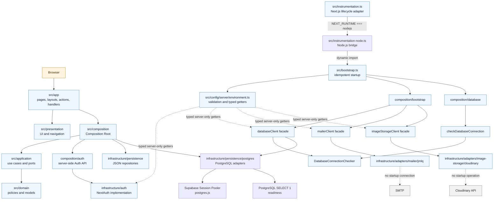

# Architecture Guidelines

These guidelines describe a layered architecture for Next.js applications. Adapt
the physical directories to the project, but preserve the responsibilities and
dependency direction.

## Layer Responsibilities

- The application layer is the framework boundary for routing, pages, layouts,
  route handlers, server actions and other input adapters. It translates
  transport concerns and delegates work to application services or the
  Composition Root. It does not contain business rules or construct concrete
  infrastructure adapters directly.
- The application layer contains use cases, commands, queries, DTOs and ports.
  It coordinates workflows without depending on infrastructure, presentation,
  composition or framework APIs.
- The domain layer contains entities, value objects, invariants and pure
  business rules. It must not depend on application, infrastructure,
  presentation, composition, frameworks, UI libraries, filesystem APIs or
  external providers.
- The infrastructure layer contains concrete repositories, persistence
  adapters, external service integrations and framework-facing server
  adapters. It implements ports defined by the domain or application layers.
- The presentation layer contains UI components, presenters, view models and
  navigation-oriented presentation logic. It does not depend on infrastructure
  or the Composition Root.
- The Composition Root assembles application services with concrete
  infrastructure implementations. It may depend on application and
  infrastructure, but not on presentation or route entrypoints.
- The configuration layer owns runtime environment reading and validation. It
  exposes typed, server-only getters and does not belong to Infrastructure,
  because configuration is a transversal application capability.
- The bootstrap layer coordinates server startup and readiness. It validates
  configuration, initializes mandatory external clients, and runs startup
  checks; it does not become a general Infrastructure barrel or request-time
  service locator.

## Organization

- Organize related responsibilities by domain or subdomain within each layer.
- Keep routing and input adapters at the framework boundary instead of placing
  use cases or domain rules in route files.
- Keep route-specific collaborators close to their route when they have no
  valid reuse outside that route.
- Expose a public module API when a module has multiple consumers; consumers
  should not depend on implementation details.
- Do not create generic layers or folders merely for symmetry. Every directory
  must contain a concrete responsibility and a real consumer.

## Dependency Direction

- Dependencies point inward toward business policies and stable contracts.
- Domain code depends only on domain contracts and language primitives.
- Application code depends on domain code and ports, never on concrete
  providers or framework APIs.
- Infrastructure implements ports and may depend on external SDKs, the
  filesystem and framework server APIs where required by its adapter role.
- Presentation consumes application contracts and presentation models, never
  concrete infrastructure services.
- Composition wires application and infrastructure together and is not a
  replacement for either layer.
- `src/config/server/environment.ts` is the only application module allowed to
  read runtime environment variables. Consumers use section-specific getters;
  adapters must not access `process.env` directly.
- The Next.js lifecycle adapter may read only `process.env.NEXT_RUNTIME` directly,
  because Next.js needs that condition statically visible to separate Edge and
  Node.js bundles. It dynamically imports `src/instrumentation-node.ts`, which
  loads `src/bootstrap.ts`; no other runtime variable may be read there.
- Inversion of dependencies is mandatory: business logic depends on ports or
  interfaces, while concrete adapters depend on those contracts.

## Current architecture

The application uses two related flows: request handling follows the dependency
direction from routes through Composition and Application toward Domain ports,
while startup follows `instrumentation.ts` into the explicit bootstrap. Concrete
providers remain behind server-only facades and are never exposed to Domain,
Application or Presentation.

Solid arrows represent application dependencies or startup orchestration.
Dashed arrows represent intentionally absent startup operations: mailer and
Cloudinary are configured, but no SMTP or Cloudinary operation runs during
startup. PostgreSQL readiness uses `SELECT 1` through the Session Pooler.
Database migrations are deployment artifacts under `supabase/migrations/` and
are executed explicitly through Supabase CLI, never from bootstrap. `Application`
knows only ports; `Composition` is the place where those ports meet concrete
Infrastructure adapters.

## Persistence

- Keep persistence details behind repositories or persistence adapters.
- Keep filesystem paths, serialization formats, locks, transactions and
  provider-specific errors inside infrastructure.
- Application services express persistence needs through ports rather than
  importing a database, JSON adapter or SDK.
- Preserve transaction, atomicity and rollback guarantees at the persistence
  boundary when the underlying operation requires them.
- Do not expose secrets, credentials or persistence-only records to client
  components.
- Keep external SDKs, concrete providers and their types inside Infrastructure.
  Public facades use capability names such as `databaseClient`, `mailerClient`
  and `imageStorageClient`, without leaking provider instances or types.
- Initialize external clients through Composition and `bootstrap.ts`. Client
  construction and remote readiness checks are separate operations. The current
  database facade checks PostgreSQL with `SELECT 1` through the configured
  Session Pooler.
- PostgreSQL/Supabase is the only runtime persistence implementation. Do not
  add JSON fallback repositories or translate legacy JSON IDs at runtime.
- Store deployable schema migrations and data migrations in
  `supabase/migrations/`, not in the runtime `src/` tree. Execute them with the
  package scripts after linking the intended Supabase project.
- `CurrentDaycareProvider` is a provisional PostgreSQL adapter used to obtain the
  single operational daycare for the login default. It must be replaced by an
  explicit daycare selector when multiple daycares are exposed to users.

## Server and Client Boundaries

- Keep server components as the default.
- Use client components only when state, event handlers, browser APIs or a
  client-only library is required.
- Client components must receive only the data and callbacks they need through
  serializable props.
- Client components must not import infrastructure, filesystem APIs, private
  configuration, server-only modules or persistence collections.
- Route entrypoints and server actions may use framework server APIs, but must
  delegate business behavior to application services assembled by composition.
- Server route entrypoints must not import PostgreSQL clients or repositories
  directly; concrete database assembly belongs in `src/composition/`.
- `src/bootstrap.ts` and all external-client facades are server-only. They must
  not be imported by Client Components or browser-facing code.
- Public environment names prefixed with `NEXT_PUBLIC_` do not make a module
  safe for browser use; the server-only boundary still applies to Supabase
  client construction and configuration access.

## Architectural Verification

- Verify the dependency graph after structural changes; search for imports that
  cross a forbidden layer boundary.
- Verify that route files contain routing and input adaptation rather than
  business rules or concrete adapter construction.
- Verify that every concrete adapter implements a stable port and that the
  Composition Root is the only assembly point.
- Verify Server/Client boundaries, private configuration access and data
  projection before exposing a component to the browser.
- Verify that `instrumentation.ts` remains a minimal Next.js lifecycle adapter,
  that it dynamically imports bootstrap code only for Node.js, and that startup
  initialization is idempotent.
- Verify that Auth consumers use `src/composition/auth/` rather than a direct
  Infrastructure barrel, and that no legacy `@/auth` entrypoint remains.
- Verify that persistence data remains in its approved infrastructure boundary,
  that no accidental duplicate implementation exists, and that empty
  directories are not introduced.
